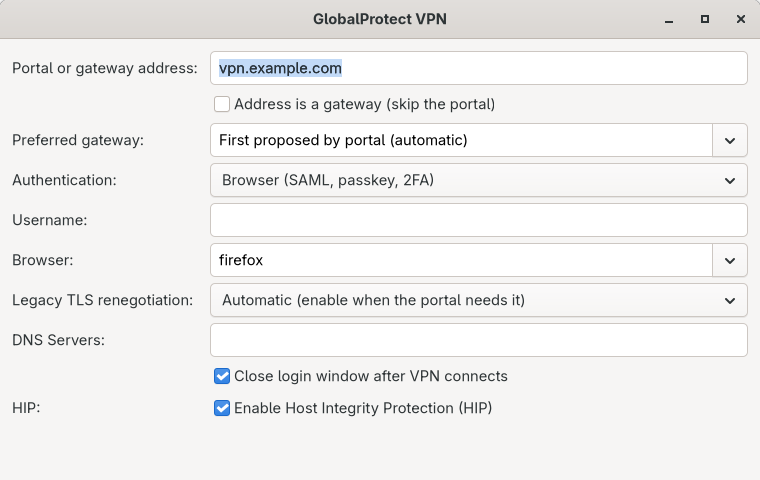

# GlobalProtect VPN for NetworkManager

Connect to a GlobalProtect VPN from GNOME Settings or KDE Plasma, using your
browser for SAML/SSO and two-factor authentication. Standard password and OTP
logins are supported too.

This fork adds optional **automatic closing of the dedicated SSO login window**
after the VPN connects, with Ubuntu and Arch packaging. GNOME and KDE Plasma
adapters keep your existing browser session and leave your other windows open.
Firefox uses a normal dedicated window; Chromium-family browsers use app mode.

## Screenshots



<details>
<summary>Desktop integration screenshots</summary>
<p>


</p>
</details>

## Install or build

**Ubuntu:** use the matching core and desktop `.deb` files from
[PR test builds or published releases](https://github.com/NicoCatalano/GlobalProtect-SAML-NetworkManager/releases).
Disconnect the VPN, then install both packages together:

```bash
sudo apt install ./network-manager-gpclient_*.deb ./network-manager-gpclient-gnome_*.deb
```

For KDE, replace the GNOME package with `network-manager-gpclient-plasma`.
The fork's APT repository is **not published yet**; its setup is documented
[separately](docs/APT_REPO.md).

**Build from source:** use a full recursive checkout, then choose your platform:

```bash
git clone --recurse-submodules https://github.com/NicoCatalano/GlobalProtect-SAML-NetworkManager.git
cd GlobalProtect-SAML-NetworkManager
```

Until PR #1 is merged, select the feature branch:

```bash
git switch codex/gnome-sso-window
```

- **Arch:** run `./scripts/build-arch.sh`, then follow the
  [verified package installation steps](docs/gnome-sso-window.md#arch-build-and-install).
- **Ubuntu:** follow the [native or Docker build instructions](docs/BUILD.md).

## Connect

1. Open your desktop's network settings and add **VPN → GlobalProtect**.
2. Enter your organisation's portal address and select an installed browser.
3. Connect and complete authentication. If your address is a gateway, select
   **Address is a gateway (skip the portal)**.

## Optional SSO window closing

Open the VPN configuration, tick **Close login window after VPN connects**, and
save. Leave it unchecked to keep the window open. The choice is stored per VPN
connection; no `gsettings` command is needed. The configuration form is wider,
with scrolling in the GTK editors so its fields remain reachable.

Adapters are provided for **GNOME 42-51** (including Ubuntu 22.04) and **KDE
Plasma 5/6**, on X11 and Wayland. GNOME needs its installed extension enabled;
KDE loads the packaged KWin script for each login. Follow the
[setup and test guide](docs/gnome-sso-window.md).

Live tests so far cover the earlier GNOME Wayland implementation on Arch 51.1
with Firefox and Ubuntu 26.04 with Firefox and Chromium. The new checkbox,
GNOME 42 and KDE adapters have automated coverage; live desktop verification is
still required. Ordinary VPN login remains available if tracking is unavailable.

## Technical documentation

[Configuration, browser behavior and troubleshooting](docs/TECHNICAL.md) ·
[Build and tests](docs/BUILD.md) · [Documentation index](docs/README.md)

Fork of [WMP/GlobalProtect-SAML-NetworkManager](https://github.com/WMP/GlobalProtect-SAML-NetworkManager),
using [GlobalProtect-openconnect](https://github.com/yuezk/GlobalProtect-openconnect)
for the VPN backend. See [license and copyright](debian/copyright).
